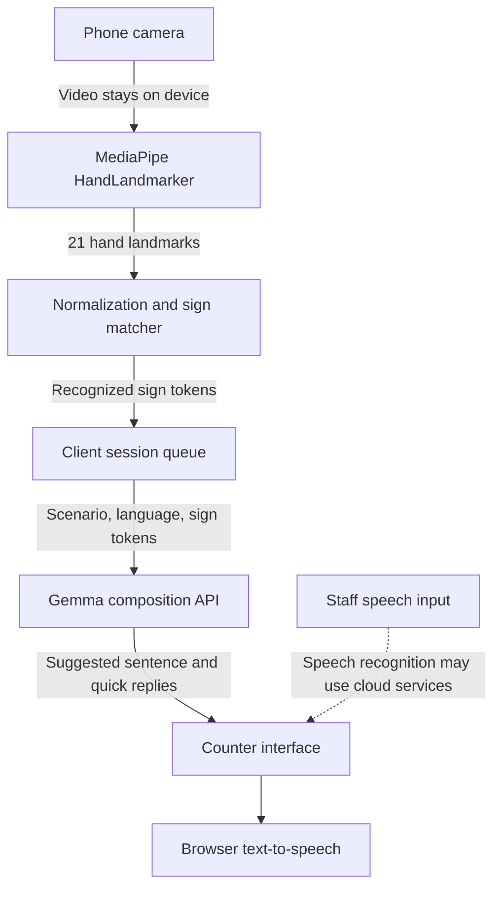

# GOLan

**One phone. Two languages. Zero silence.**

Sanket is a privacy-first communication bridge for high-stakes public service counters, including hospitals and banks. It is designed to help Deaf and hard-of-hearing people communicate using a curated set of Indian Sign Language (ISL) glosses, while helping counter staff respond in a local spoken language.

The project was built for **Hacktoberfest Hack Day Pune (NST ADYPU x MLH), Main Track**.

> **Project status:** This checkout contains the on-device hand-vision and sign-matching prototype, including the `/vision-test` harness. The Gemma composition API, session queue, speech input, and full counter experience are part of the described system, but are not present in this repository snapshot.

## The problem

India has a significant shortage of qualified ISL interpreters relative to the Deaf population. The project brief estimates fewer than 1,500 qualified interpreters serving 5 to 18 million Deaf citizens. In settings such as emergency triage and banking, that gap can make routine or urgent interactions difficult.

Sanket explores a lightweight counter-side tool: recognize a limited vocabulary of signs locally, turn recognized glosses into a concise sentence, and provide staff with quick replies. It is an assistive prototype, not a replacement for a qualified interpreter.

## How it works



In the intended end-to-end system, camera frames are processed on the phone and are not uploaded. Only recognized text glosses and concise interaction context are sent to the composition API. Text-to-speech uses the browser; speech recognition may send audio to a browser vendor's cloud service, depending on implementation and browser.

## Technology

| Area | Technology | Processing |
| --- | --- | --- |
| Hand tracking | `@mediapipe/tasks-vision` HandLandmarker | On device, using WASM with GPU/CPU fallback |
| Sign matching | TypeScript clip matcher | On device |
| Sentence composition (intended) | Google Gemini API with `gemma-4-26b-a4b-it` | Cloud API; receives text glosses, not video |
| Speech output (intended) | Browser `SpeechSynthesis` | Browser/device dependent |
| Speech input (intended) | Browser `SpeechRecognition` | Hybrid; may use cloud services |
| Web framework | Next.js App Router, React, TypeScript | Client and server |

MediaPipe assets are served locally first, with a CDN fallback if the local files cannot be loaded. The local asset copy is prepared by the `postinstall` script.

## Vision prototype

The code currently in this repository provides:

- Local webcam capture and MediaPipe hand-landmark detection.
- Wrist-relative, hand-size-normalized landmark vectors based on 21 points.
- Resampling of motion clips to 16 frames and matching across small temporal shifts.
- A hold threshold and cooldown to reduce repeated sign emissions.
- A `/vision-test` page for viewing landmarks, recording labeled clips, and exporting sign packs.
- A default sign pack at `public/packs/default.json`.

The matcher recognizes examples in a supplied sign pack; the included vocabulary is not a complete ISL lexicon. Recognition quality depends on the examples, camera conditions, and user signing.

## Run locally

Requirements: Node.js and npm, plus a browser with camera access. Camera access generally requires `localhost` or HTTPS.

```bash
npm install
npm run dev
```

Open [http://localhost:3000/vision-test](http://localhost:3000/vision-test) and allow camera access. Use the page to record labeled clips, save examples into the in-memory pack, and export a pack as JSON.

Other available scripts:

```bash
npm run build
npm start
```

## Design decisions

### Privacy-preserving vision

Hand tracking and gesture matching run in the browser. Video frames do not need to leave the device. The intended composition request contains text glosses and limited context rather than images or video.

### Scale- and position-tolerant matching

Landmarks are translated relative to the wrist and scaled against the wrist-to-middle-finger-knuckle distance. Motion examples are resampled to 16 frames; the matcher compares nearby temporal alignments to tolerate differences in signing speed.

### Resilient composition (intended)

The design calls for a 1.5-second pause before composing a phrase and a 6-second API timeout. If composition is unavailable, the client should speak the recognized glosses directly so the interaction can continue. These API and fallback behaviors are not implemented in the current checkout.

## Challenges addressed

- **Large repository artifacts:** The project encountered GitHub push rejection after accidentally tracking `node_modules`. The reported resolution was to ignore generated dependencies and build output, including `node_modules/`, `.next/`, and `.venv/`, and clean the affected commit history.
- **Motion-sign drift:** Single-frame matching was not sufficient for dynamic signs. The matcher now compares resampled clips across temporal shifts from -3 to +3 frames.
- **App Router setup:** A root layout is required by Next.js App Router. The current checkout includes the vision test route layout; add or restore a root `app/layout.tsx` before treating this snapshot as a complete runnable product.

## Limitations

- Sanket recognizes a curated, high-priority vocabulary, not full continuous ISL or ISL grammar.
- The language model is intended to compose sentences from text glosses; it does not interpret video.
- Browser speech recognition is not guaranteed to run locally and may route audio through a cloud provider.
- Model-generated wording must not invent medical or financial details. Staff and users should verify important information.
- Sign recognition is experimental and should not be used as the sole channel for emergency, medical, or financial decisions.

## Team contributions

- **Vision:** MediaPipe WASM pipeline, camera harness, normalization, matching, and the `/vision-test` template-capture UI.
- **Backend and language model:** Shared sign contracts, planned Gemma API wrapper and composition routes, and the planned 1.5-second session pause buffer.
- **Experience and pitch:** Planned mobile-first counter experience and deployment pipeline, ISL vocabulary selection, and project documentation.

## License and attribution

The project is intended to be released under the Apache License 2.0. Add the repository's `LICENSE` file before distributing it under that license. MediaPipe Tasks Vision is distributed under Apache 2.0. Google Gemma is subject to the applicable Gemma Terms of Use; Gemini API usage is subject to Google's API terms.
