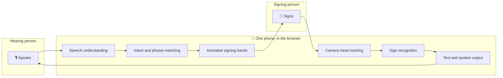
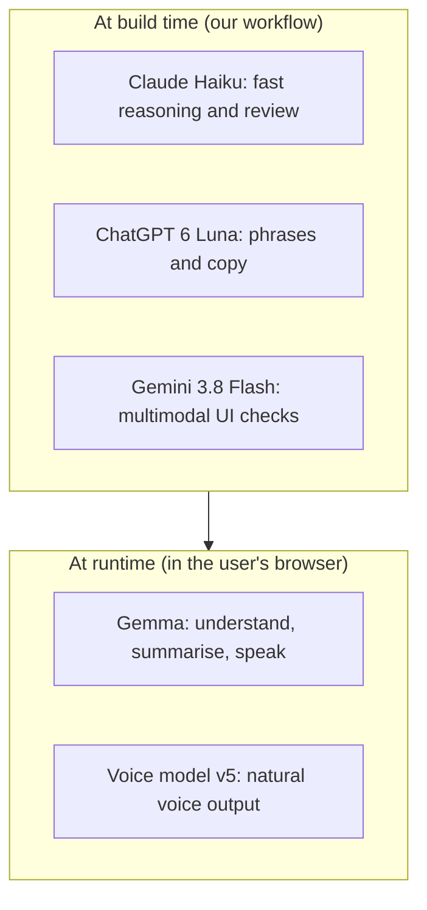

<div align="center">

# 🤟 SignBridge

### One phone. Two languages. Zero silence.

**A real-time, two-way sign language ⇄ speech interpreter that runs entirely in your browser.**
No server. No account. No cloud for the core pipeline.


<!-- EDIT: add a demo GIF or screenshot here -->
<!--  -->

[Live Demo](#) · [Demo Video](#) · [Report a Bug](../../issues)

</div>

---

## 📖 Table of Contents

- [The Problem](#-the-problem)
- [The Solution](#-the-solution)
- [Features](#-features)
- [How It Works](#-how-it-works)
- [Best Use of Every AI Model](#-best-use-of-every-ai-model)
- [Best Use of Gemma](#-best-use-of-gemma)
- [Built With AI Coding Agents](#-built-with-ai-coding-agents)
- [Privacy by Design](#-privacy-by-design)
- [Getting Started](#-getting-started)
- [Project Structure](#-project-structure)
- [Roadmap](#-roadmap)
- [Team](#-team)
- [License](#-license)

---

## 🚧 The Problem

Millions of Deaf and hard-of-hearing people communicate in sign language, but most hearing people do not know it. At a hospital desk, a pharmacy counter, a ticket window or a classroom, that gap means:

- waiting for a human interpreter who may not be available, or may be expensive
- writing notes back and forth on paper
- missing information that matters, such as a diagnosis, a dosage or a direction

Existing tools usually need an account, a server, a subscription or a stable internet connection, and they send a person's face and voice to the cloud.

## 💡 The Solution

**SignBridge turns any phone into an interpreter.** Open a web page, allow the camera and microphone, and put the phone between two people:

- When the **hearing person speaks**, SignBridge shows the reply as **animated signing hands** on screen.
- When the **signer signs**, SignBridge reads the hands through the camera and shows the result as **text** (and can speak it aloud).

One phone. Two languages. Nothing to install.

## ✨ Features

| | Feature | What it does |
|---|---|---|
| 🎙️📷 | **Guided permission step** | A clear camera and microphone prompt that scrolls to a rounded camera cutout, so people know exactly what is being used and why. |
| 🗣️➡️🤟 | **Speech → Sign** | Speech is understood and replied to with two animated signing hands. Built-in phrases include greetings, *"the dog is running"* and common back and neck pain phrases. |
| 🤟➡️💬 | **Sign → Text** | Hand movements seen through the camera are turned into readable text, and can be spoken aloud. |
| 🌐 | **Runs in the browser** | The core pipeline needs no server, no sign-up and no cloud round trip. |
| 🔒 | **Private by default** | Camera frames and microphone audio for the core pipeline stay on the device. |
| 📱 | **One-phone design** | Built for a single phone placed between two people, not for two devices. |

## ⚙️ How It Works



**Two directions, one screen:**

1. **Speech → Sign.** The microphone captures speech, which is converted to text and matched to a phrase. The two on-screen hands then sign the reply.
2. **Sign → Text.** The camera watches the signer's hands, the recognizer maps the movement to words, and the result appears as text and, optionally, speech.

> A backend can be connected later for heavier models and a larger sign vocabulary. The core experience does not depend on it. See the [Roadmap](#-roadmap).

## 🧠 Best Use of Every AI Model

SignBridge was designed, built and polished with several AI models, each used for what it does best. Nothing is there just to add a logo.

| Model | Role in the project | Why this model |
|---|---|---|
| **Gemma** (open weights) | Speech understanding, text-to-speech support and summarising conversations. See [Best Use of Gemma](#-best-use-of-gemma). | Open weights, multimodal, small enough for edge and local use. It is the model that fits the on-device, privacy-first idea. |
| **Claude Haiku** | Fast reasoning for phrase matching, rewriting speech into short, sign-friendly sentences, and quick code reviews while building. | Low latency and strong instruction following for small, frequent tasks. |
| **ChatGPT 6 Luna** | Generating and refining the phrase library, test sentences and UI copy. | Strong at broad language coverage and creative variation. |
| **Gemini 3.8 Flash** | Fast multimodal checks, such as reviewing screenshots of the UI and describing hand poses during development. | Quick, low-cost multimodal understanding. |
| **Voice model v5** | Natural-sounding spoken output for recognised signs. | Gives the signer a clear, human voice in the conversation. |

<!-- EDIT: adjust the "Role in the project" column so it matches exactly what each model did in your build. -->

### Division of labour at a glance



## 💎 Best Use of Gemma

Gemma is the model that makes SignBridge's promise believable: *no server, no cloud, no account.*

**Why Gemma is the right fit**

- **Open weights under Apache 2.0.** It can be inspected, modified and shipped with the project, with no vendor lock-in.
- **Multimodal and speech-aware.** The smaller Gemma 4 sizes accept audio input, which suits a speech-first app.
- **Small enough for the edge.** The E2B and E4B sizes are designed for laptops and phones, which matches the one-phone idea.
- **Multilingual.** Gemma covers many languages, a natural path toward supporting more spoken and signed languages.

**What Gemma does in SignBridge**

1. **Speech understanding.** Turns what the hearing person says into text and meaning, so the right signs can be chosen.
2. **Summarising.** Condenses a longer conversation into a short summary that either person can keep, such as the key points from a doctor's visit.
3. **Text-to-speech support.** Prepares clean, speakable text from recognised signs so the voice output sounds natural.

> **Note:** Gemma 4 *understands* audio input; it does not generate audio itself. SignBridge uses Gemma to prepare and understand text and speech, and uses a voice model (v5) to produce the spoken audio.

## 🤖 Built With AI Coding Agents

SignBridge was built by a small team in a single overnight hackathon, so AI coding agents were part of the team.

| Agent | How we used it |
|---|---|
| **GitHub Copilot** | Inline completions and boilerplate in the editor: event handlers, camera and microphone setup, and repetitive UI code. |
| **Antigravity** | Agent-driven tasks across the project, such as wiring screens together and iterating on larger changes. |
| **Cursor** | Multi-file edits and refactors, UI polish and fast debugging with the whole codebase in context. |

**Our rule:** every AI-written change was run, looked at and understood by a human before it was committed.

## 🔒 Privacy by Design

- The core pipeline runs **in the browser**. There is no SignBridge server in the loop.
- **No account** and **no sign-up**.
- Camera frames and microphone audio used for the core pipeline are **not uploaded**.
- The permission step is explicit, so people always know what is turned on.

If you add a backend later, keep it opt-in and say clearly what is sent.

## 🚀 Getting Started

### Requirements

- A modern browser (Chrome, Edge, Safari or Firefox) with camera and microphone support
- HTTPS or `localhost`, which browsers require for camera and microphone access

### Run locally

```bash
# 1. Clone the repository
git clone https://github.com/<your-username>/signbridge.git
cd signbridge

# 2. Serve the files with any static server, for example:
npx serve .
# or
python3 -m http.server 8000
```

<!-- EDIT: replace the steps above with your real install and run commands if you use a build tool such as Vite or Next.js. -->

Open the printed address, allow **camera** and **microphone**, put the phone between two people, and start talking and signing.

### Try it out

- Say **"Hello"** and watch the hands greet you.
- Say **"The dog is running"** and see the sentence signed.
- Say a phrase about **back pain** or **neck pain**, the kind you would say at a clinic.
- Sign something to the camera and read it as text.

## 🗂️ Project Structure

```text
signbridge/
├── index.html          # Landing page and main app shell
├── assets/             # Images, icons and hand animations
├── src/                # Application code
├── docs/               # Screenshots, GIFs and diagrams
├── LICENSE
└── README.md
```

<!-- EDIT: update this tree so it matches your repository. -->

## 🛣️ Roadmap

- [x] Camera and microphone permission step with a rounded camera cutout
- [x] Animated signing hands that respond to speech
- [x] Sign-to-text view
- [ ] Connect an optional backend for larger models and more vocabulary
- [ ] More phrases, including medical, travel and everyday phrases
- [ ] More sign languages (for example Indian Sign Language) and spoken languages
- [ ] Offline support as an installable app
- [ ] Conversation summaries saved to the device
- [ ] Feedback from Deaf and hard-of-hearing users, who should shape every next step

## 🙌 Team

Built for **Hacktoberfest 2026, Hack Day Pune × NST ADYPU**, powered by NST SDC.

| Name | Role |
|---|---|
| <!-- name --> | <!-- model and backend --> |
| <!-- name --> | <!-- frontend and demo --> |
| <!-- name --> | <!-- product and pitch --> |

## 🤝 Contributing

SignBridge is open source, and contributions are welcome, especially from sign language users, interpreters and accessibility experts.

1. Fork the repository
2. Create a branch: `git checkout -b feature/my-idea`
3. Commit your changes
4. Open a pull request

## 📄 License

Released under the [Apache License 2.0](LICENSE).

## 🙏 Acknowledgements

- Google DeepMind for the open-weight Gemma models
- The AI models and coding agents credited above
- Major League Hacking, NST ADYPU and NST SDC for hosting the event
- The Deaf and hard-of-hearing community, whose needs inspired this project

---

<div align="center">

**One phone. Two languages. Zero silence.** 🤟

</div>
